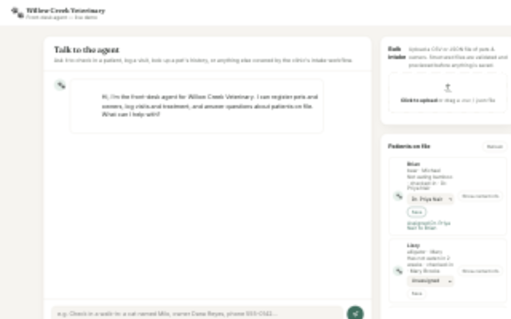

# UI-001: Assign a veterinarian to a pet from the UI

**Priority:** P1  **Owner:** Orchestrator (Claude Sonnet 5.5, this thread)
**Origin:** "I'm unable to assign a veterinarian to a pet for care." Investigation found the data layer works, but the only route was asking the chat agent (which now needs an approval click), the UI has no control for it, visits are not shown anywhere in the UI, and no roster exists so names are unvalidated.

## Story

**As a** front-desk staff member
**I want** to pick a veterinarian from a list and assign them to a pet's care in the UI
**So that** I do not depend on the chat agent or free-typed names.

## Design (fixed by the orchestrator so the two build agents can work in parallel)

- **Roster:** `agent-home/veterinarians.json`, a JSON array of `{ "id": "vet-001", "name": "Dr. First Last", "specialty": "..." }`. It lives outside `agent-home/memory/` on purpose: that directory is a Docker volume that shadows image contents, so a roster there would be empty in a container. The roster is clinic reference data edited by an administrator, not agent-written data.
- **Stored value:** `visit.assignedVeterinarian` stays a string holding the roster `name` (no schema or data migration).
- **API (new, human-initiated, no LLM, so no approval gate; the existing request guard and CSRF header still apply):**
  - `GET /api/veterinarians` returns the roster.
  - `POST /api/patients/:id/assign-veterinarian` with body `{ "veterinarianId": "vet-001" | null, "reasonForVisit"?: string }`. If the patient has an open visit (status not `closed`), update the most recent open visit. Otherwise create a new `checked-in` visit (`reasonForVisit` required in that case). `null` clears the assignment on an open visit. Unknown patient: 404. Unknown `veterinarianId`: 400. Returns the saved visit.
  - Writes go through the existing store so snapshots and the change log record them (source `ui`).
- **UI:** the patient list shows each pet's open visit and assigned veterinarian, with a roster dropdown and a Save button. A pet with no open visit shows a "Check in for care" form (reason + veterinarian). Visible success and error feedback. All text rendered through the existing escaping.

## Acceptance criteria

1. `agent-home/veterinarians.json` exists with exactly 5 valid, unique, fictional veterinarians.
2. `GET /api/veterinarians` returns the roster; invalid roster file fails clearly (not silently empty).
3. The assign endpoint behaves as specified above (update open visit, create when none, clear with null, 400/404 cases) and is recorded in the change log.
4. The UI lets staff assign, reassign, and clear a veterinarian for a pet, and check in a pet that has no open visit.
5. The UI shows the assigned veterinarian per pet after a refresh.
6. No LLM or approval-gate involvement in this path; contact PII stays hidden as before; XSS-safe rendering.
7. The existing 57 SEC-002 tests still pass; new tests cover the roster, the endpoints and the UI wiring.

## Sub-agents

| # | Role | Model | Scope |
|---|---|---|---|
| 1 | UI + API build | Claude Sonnet 5.5 | `lib/veterinarians.js`, routes in `server.js`, `public/*` |
| 2 | Roster data | Codex gpt-6-luna | `agent-home/veterinarians.json` only |
| 3 | Test and validate | Claude Sonnet 5.5 | tests, full run, end-to-end check, report to orchestrator |

Orchestrator: sequencing, contract above, review, board, commit. Sub-agent 3 starts only when 1 and 2 are done.

## Evidence

Captured by the orchestrator from the real app (a copy of this branch on a scratch data directory, port 3077): Brian's open visit was assigned to **Dr. Priya Nair** from the roster dropdown. The care line now reads "checked-in · Dr. Priya Nair", the dropdown shows the selection, and the inline status confirms "Assigned Dr. Priya Nair to Brian". The saved visit in `visits.json` has `"assignedVeterinarian": "Dr. Priya Nair"`.

Known visual issue seen in the capture: the patient text column is narrow (about 117 px) because the contact button sits beside it, so the care line wraps heavily. Functional, but worth a follow-up layout tweak.

## Board

| Stage | Sub-agent 1 (UI/API) | Sub-agent 2 (roster) | Sub-agent 3 (validate) | Story |
|---|---|---|---|---|
| **Current** | Completed | Completed | Completed | Completed |

## Stage log

| Timestamp (UTC) | Item | Move | Note |
|---|---|---|---|
| 2026-10-18T01:51:19Z | Story | → New | Story and design written by orchestrator |
| 2026-10-18T01:51:19Z | Sub-agent 1 (UI/API) | → Development Ready | Contract and acceptance criteria confirmed testable |
| 2026-10-18T01:51:19Z | Sub-agent 2 (roster) | → Development Ready | Contract and acceptance criteria confirmed testable |
| 2026-10-18T01:51:19Z | Story | → Development Ready | Contract and acceptance criteria confirmed testable |
| 2026-10-18T01:51:19Z | Sub-agent 1 (UI/API) | → In Progress | Dispatched Claude Sonnet 5.5 |
| 2026-10-18T01:51:19Z | Sub-agent 2 (roster) | → In Progress | Dispatched Codex gpt-6-luna |
| 2026-10-18T01:51:19Z | Story | → In Progress | Sub-agents 1 and 2 running in parallel |
| 2026-10-18T01:52:04Z | Sub-agent 2 (roster) | → Completed | 5 vets written and validated (JSON, unique ids/names, 5 specialties); orchestrator re-read file |
| 2026-10-18T01:53:16Z | Sub-agent 1 (UI/API) | → Completed | lib/veterinarians.js, lib/assignment.js, 2 routes, patient-list UI built; npm test 57/57; orchestrator reviewed diff |
| 2026-10-18T01:53:16Z | Sub-agent 3 (validate) | → In Progress | Dispatched Claude Sonnet 5.5 (tests and validation) |
| 2026-10-18T01:53:16Z | Story | → QA | Sub-agents 1 and 2 complete; sub-agent 3 validating |
| 2026-10-18T01:54:25Z | Story | → QA | Screenshot of working assignment added to story (docs/ui/screenshots/after-assign.png) |
| 2026-10-18T01:55:57Z | Sub-agent 3 (validate) | → Completed | 35 new tests (33 pass, 2 fail by design); report: 2 defects + 2 UI issues; npm test 90/92 |
| 2026-10-18T01:55:57Z | Story | → In Progress | QA rejected: path leak in 500s, concurrent check-in duplicates, unlisted-vet Save wipes name, roster failure blanks list; rework round dispatched |
| 2026-10-18T01:55:57Z | Sub-agent 1 (UI/API) | → In Progress | Rework round 2 dispatched |
| 2026-10-18T01:57:58Z | Sub-agent 1 (UI/API) | → Completed | Rework done: path leak, serialized check-ins, unlisted-vet Save, list resilience |
| 2026-10-18T01:59:20Z | Story | → Completed | Orchestrator verification: npm test 92/92 x3; live browser run on real data: unlisted-vet Save is a no-op with hint, assign, check-in, clear all work; data restored afterwards |
